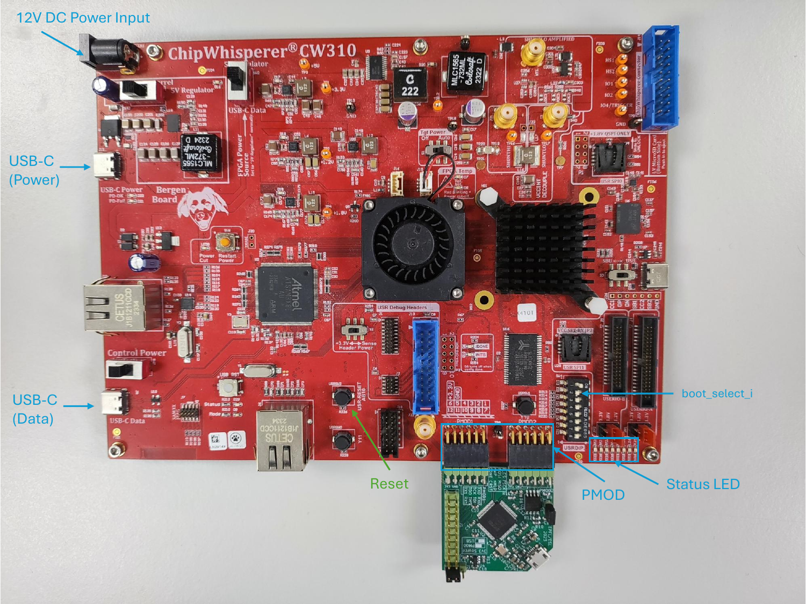
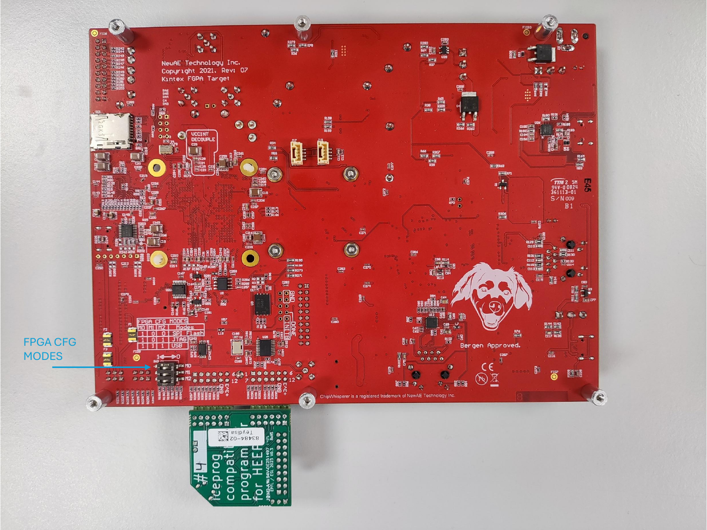

# ChipWhisperer CW310 Bergen Board (Kintex FPGA Target): Use Guide

X-HEEP supports the CW310 Bergen Board with the Kintex-7 XC7K410T FPGA. The
board target is `bergen`. Vivado board files are not required.





Connect the EPFL X-HEEP programmer to PMOD1 and PMOD2 for JTAG and UART. Set
USRDIP1 (`boot_select`) to `0` for JTAG loading. USRSW2 is the X-HEEP reset
button. The FPGA configuration switches M0/M1/M2 are on the back of the board.
The printed table specifies `1/1/1` for USB configuration.

Generate the MCU and build the bitstream:

```bash
make mcu-gen
make vivado-fpga FPGA_BOARD=bergen
```

Program the generated `xilinx_core_v_mini_mcu_wrapper.bit` using the CW310 USB
interface or Vivado Hardware Manager. See [Run on FPGA](./RunOnFPGA.md) for the
general build instructions.

Build an application for the board:

```bash
make app PROJECT=hello_world TARGET=bergen
```

Use the [debug guide](./../How_to/Debug.md) to load `sw/build/main.elf` over
JTAG. The EPFL programmer UART uses 9600 baud. The `hello_world` application
was verified on the board and printed `hello world!` over the serial port.

The board uses a 25 MHz input clock to generate a 15 MHz X-HEEP reference
clock. The constraints map the reset, boot selection, status LEDs, GPIO, JTAG,
UART and SPI signals.
